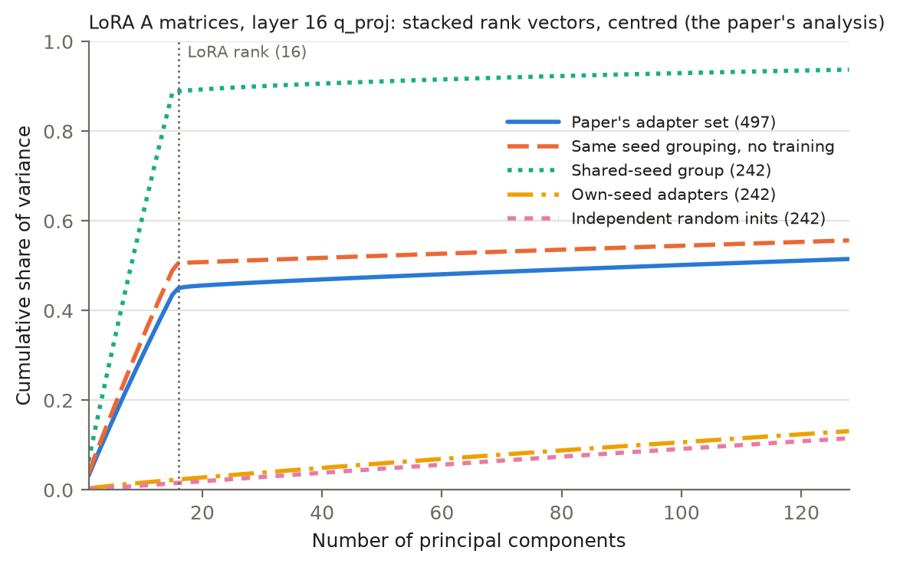

# Shared Initialisation Confounds the LoRA Evidence for Universal Weight Subspaces

**Noah Persaud**\
Holdout Labs\
noah@holdoutlabs.ai

*October 11, 2026*

## Abstract

Kaushik et al. (2026a; arXiv 2512.05117 v3) report that about 500 LoRA adapters for Mistral-7B, each
trained on a different task, share a low-dimensional "universal" subspace, with "most information
concentrated in 16 or fewer directions across all layers". LoRA initialises its down-projection A
at random and its up-projection B at zero, and A moves little in training. We therefore asked how
much of this structure comes from shared initialisation. On the adapters listed in the paper's Table 10 (497 inferred to have been used for fitting;
including all 502 changes nothing material), 255 of 497 (51%) form one group whose A matrices are nearly identical across
different tasks (median pairwise cosine 0.90), consistent with a reused random initialisation.
Across the whole public collection the fraction is 38%, so the paper's set is enriched for it. In
the paper's analysis, this group puts 86-90% of A's variance in 16 directions; the 242 adapters
outside it put 2-5%, close to independent random matrices at the same sample size (1.6%). A
simulated collection with the same grouping and no training at all shows the same rank-16 knee.
The effect survives a factorisation-invariant analysis of ΔW = BA on the input side. The output
side behaves differently: it shows shared structure that is present in both inferred groups,
exceeds a null that preserves each adapter's singular values in every layer we examined, and
outside the first layer is little reduced by removing the base model's dominant weight directions. In a controlled experiment on Qwen2.5-0.5B-Instruct, the same ten tasks show the rank-16 A subspace when they share an initialisation and the random level when they do not; a rank-16 basis fitted on other tasks captures little of a held-out task's update, and projecting one side at a time shows that within a shared initialisation the loss comes mainly from the fitted output basis, for factor-based and factorisation-invariant bases alike. Although the fitted output bases retain little update energy, they preserve partial performance on two of the nine learned tasks (paraphrase and concise rewriting). We conclude that the input-side
(A) evidence for a universal LoRA subspace is largely an initialisation artefact, while a weaker,
genuinely shared output-side structure deserves separate study. We recommend that analyses of
adapter collections report seeds, group by inferred initialisation, use factorisation-invariant
statistics and compare against strength-matched nulls.

## 1. Introduction

The Universal Weight Subspace Hypothesis (Kaushik et al., 2026a, arXiv 2512.05117; we review v3, dated
2026-10-05) proposes that neural networks converge to shared spectral subspaces "regardless of
initialization, task, or domain". One line of evidence is a collection of LoRA adapters (Hu et al.,
2022) for Mistral-7B-Instruct-v0.2, each trained on a Natural Instructions task (Wang et al., 2022)
and released by Brüel-Gabrielsson et al. (2025). The headline for this collection, "most
information concentrated in 16 or fewer directions across all layers", is in the caption of the
paper's Figure 4. For each layer, the paper concatenates the rank vectors of all adapters into a
500r × d matrix, separately for the factors A and B, subtracts the feature-wise mean and extracts
principal directions (Appendix B.5); the orientation of A and B follows from this shape. The paper
acknowledges that "the LoRA factorization is not unique", notes that "a gauge-invariant
alternative would perform the same analysis directly on ΔW", and states that its analysis
"characterizes recurring structure in the learned and stored LoRA parameterization, rather than a
gauge-invariant property of the equivalent full update ΔW=BA". We found no seed information and no
random-matrix baseline for this analysis anywhere in the paper.

Two facts make initialisation a candidate explanation. First, PEFT initialises A with a
Kaiming-uniform draw from the global random generator, so adapters created with the same seed and
configuration start from an identical A, provided the generator is in the same state, with the same
sequence of earlier draws, when A is drawn. Second, A moves little in training. In our own controlled
runs on Qwen2.5-0.5B-Instruct and Llama-3.2-1B-Instruct (40 runs; [`dev_scale_report.md`](dev_scale_report.md)),
‖A − A₀‖_F / ‖A₀‖_F was 0.04-0.22, and under a shared seed the input subspaces of unrelated tasks
overlapped by 97-99%. If many adapters in a collection share an initialisation, the stacked A
matrix contains the same r = 16 random vectors many times, and PCA finds about 16 dominant
directions whatever the tasks.

Contributions:

1. On the paper's adapter list (the inferred fitting set, Section 2), we identify one large group of adapters with a common,
   initialisation-like A (51%), robust to the grouping threshold and identical in all layers
   examined (Section 3.1).
2. A matched comparison, size-matched random nulls and a no-training simulation show that the
   rank-16 A spectrum comes from this group (Section 3.2, Figure 1).
3. A crossed task × initialisation experiment on Qwen2.5-0.5B-Instruct separates seed from task directly,
   and one-sided projections locate where a fitted subspace fails to carry a new task (Section 3.3).
4. A factorisation-invariant analysis with strength-matched nulls separates what the shared
   initialisation explains (input side) from genuinely shared structure (output side), and tests
   how much of the latter is the base model's dominant directions (Sections 3.4-3.5).
5. The same grouping affects joint-basis compression of this collection (Section 3.6).

We do not test the paper's results on fully trained models (ViTs, ResNets), which do not involve
LoRA initialisation.

## 2. Setup

**Adapters.** Table 10 of v3 lists 502 adapters `Lots-of-LoRAs/Mistral-7B-Instruct-v0.2-4b-r16-taskNNN`
(all present in the public collection of 904 rank-16 adapters). Five are coloured as
out-of-distribution evaluation models. We infer from the colouring that the other 497 were used to
fit the subspace and call them the *inferred fitting set*; "the paper's set" below means this set.
The split is not confirmed by the authors, so Section 3.1 reports the sensitivity to including all
502. Each adapter
adapts the q, k and v projections of all 32 layers with rank r = 16 and scaling α/r = 2 (constant,
so it cancels in every normalised statistic below). A is r × d_in (d_in = 4,096); B is
d_out × r, with d_out = 4,096 for q and 1,024 for k and v (grouped-query attention). A **slot** is
one (layer, projection) pair; we analyse 15 slots: layers 0, 8, 16, 24, 31 × q, k, v.

**Paper-style spectrum.** For a set of N adapters, stack the r rows of each A (or the r columns of
each B) into an (N·r) × d matrix, centre feature-wise and compute eigenvalues. **Top-16 share** is
the fraction of variance in the 16 largest components; **k90** is the number of components needed
for 90% of the variance.

**Factorisation-invariant spectra.** Writing ΔW_i = B_i A_i, we use the uncentred operators
C_in = Σᵢ ΔW_iᵀ ΔW_i and C_out = Σᵢ ΔW_i ΔW_iᵀ, whose spectra do not depend on how ΔW_i is split
into factors (computed from each adapter's compact SVD via QR of B and Aᵀ). We report their top-16
share. These are one-sided measures of update energy, not PCA over vectorised updates.

**Nulls.** (i) *Size-matched independent initialisations*: N fresh Kaiming-uniform A matrices,
10 repeats. (ii) *Strength-matched*: every adapter keeps its singular values and gets random
orthonormal singular vectors, 10 repeats; this tests orientation given strength. (iii) *Unit-norm*
versions of the real data and null (every ΔW_i scaled to ‖ΔW_i‖_F = 1), which remove differences
in adapter norm and keep only within-adapter anisotropy.

**Inferred groups.** Adapters are linked when the cosine similarity of their layer-0 q_proj A
matrices exceeds 0.5; groups are connected components. We call the large component the *inferred
shared-initialisation group* and the rest *singletons*. These are inferences from A, not recovered
training histories.

## 3. Results

### 3.1 One large group shares an initialisation-like A

On the paper's 497 adapters the grouping yields one group of 255 (51%) and 242 singletons; no
other multi-member groups. Within the group, pairwise cosine of layer-0 q_proj A has minimum 0.55,
10th percentile 0.78 and median 0.90. Between groups, 98% of cosines lie within ±0.010 and the
largest is 0.044. The partition is identical for every threshold from 0.15 to 0.6, and the same
partition is obtained independently from each of the 15 slots.

*Sensitivity to the inferred split.* Including the five out-of-distribution adapters (all 502)
leaves the partition unchanged: none of the five joins the group, which stays at 255 members, and
the other 247 adapters are singletons. The full-set top-16 share of A changes by −0.004 to −0.005 in
every slot (0.43-0.45; k90 1,632-1,759).

The group's mean A behaves like an initialisation plus a small averaged change. Its kurtosis is
1.80-1.84 across slots (1.80 for a uniform distribution, 3.0 for a Gaussian); its element standard
deviation is 0.00901-0.00908 (0.00902 for PEFT's U(−1/64, 1/64)); its largest entries reach
0.016-0.020, slightly beyond the uniform bound of 0.0156, as expected if the mean includes some
learned change. Individual adapters lie a median 0.22-0.32 (10th-90th percentile 0.06-0.65) of
the mean's norm away from it. These are distances from the trained group mean, not from the
initialisation, and they bound neither an individual adapter's movement nor the median movement.
Only an aggregate statement holds: since Σᵢ‖Aᵢ − m‖² ≤ Σᵢ‖Aᵢ − c‖² for the mean m and any common
point c, the root-mean-square distance from the mean, 0.33-0.39 of the mean's norm across slots,
cannot exceed the root-mean-square distance from the shared initialisation, measured in the same
units.

**Collection-wide.** Over all 904 rank-16 adapters, 342 (38%) belong to the group. The fraction
varies with task number (25-51% across ranges). The paper's set (51%) is enriched relative to a
random 500 (39%), the lowest-numbered 500 (44%) and the whole collection (38%), and the top-16
share of layer-0 q_proj A tracks the group fraction across these sets (0.45, 0.34, 0.38, 0.32).

The model cards and `adapter_config.json` files contain no seed and no evaluation results. Seed 42
and 14 other common seeds did not match the group mean within the first 67 million draws of
PyTorch's CPU generator, and seeds 0-199 did not match at the first six draw positions; the
generator may have been advanced by other code, or the adapters created on a GPU. Nothing below
depends on the seed.

### 3.2 The rank-16 A spectrum comes from the group

| Paper-style A spectrum (15 slots) | Top-16 share | k90 |
|---|---|---|
| Paper's set (497 adapters) | 0.44-0.46 | 1,610-1,738 |
| Same grouping, pure initialisations, no training | 0.51 | — |
| Same grouping, initialisations + random movement of the measured size | 0.46-0.48 | — |
| Shared-initialisation group (242 of 255) | 0.86-0.90 | 16-90 |
| Singletons (242) | 0.021-0.052 | 1,980-2,003 |
| Independent random initialisations (242, 10 repeats) | 0.016 (sd < 0.001) | — |

(Rank caps: 4,096 for the full set; 3,871 for 242 adapters after centring.)

The paper's set shows a sharp knee at exactly the LoRA rank (Figure 1). A collection with the same
grouping and no training at all reproduces the knee, and adding random movement of the measured
size brings the top-16 share to within 0.02-0.04 of the real value. Under row stacking, the top-16
share of such a collection is roughly the shared fraction times the share of each group member's
variance carried by the common A, which is why it tracks the group fraction (Section 3.1).
Singletons are 1.3-3.3 times the size-matched random level, highest in layer 0 (0.036-0.052), so
they are close to, but not exactly, random. The rank-16 concentration is absent among them.

For B, the group and the singletons agree to within 0.015 in every slot (top-16 share 0.11-0.56),
so B has similar spectra in both groups.

*Figure 1. Cumulative variance of the paper-style A spectrum, layer 16 q_proj. The paper's set and
a no-training simulation with the same grouping both jump at the LoRA rank; adapters outside the
group are close to independent random matrices.*

### 3.3 Crossed task × initialisation experiment

To separate initialisation from task directly, we trained the same 10 tasks (our synthetic panel:
hidden-rule sentiment, NLI, paraphrase, JSON extraction, concise and verbose rewriting, Python,
arithmetic, clinical extraction, formatting) on Qwen2.5-0.5B-Instruct, rank 16 on all seven projection
types (168 modules), with identical data, optimiser and early stopping, under two regimes:
**shared**, one random A per seed used by every task (two seeds, so two shared initialisations),
and **independent**, a separate random A per task and seed. A hardware check retrained four
independent runs on a different GPU (RTX 3080 vs A100) from the same initialisation: ΔW cosine
0.88-0.94 and A cosine ≥ 0.997, so training is reproducible across machines.

| Paper-style A spectrum, 10 adapters per group | Top-16 share (median over 168 modules) |
|---|---|
| Shared initialisation (each of the two groups) | 0.99 |
| Both shared groups pooled (20 adapters) | 0.59 |
| Independent initialisations | 0.18 |
| Independent random matrices, same N | 0.18 |

With everything else fixed, the rank-16 subspace appears when tasks share an initialisation,
splits into two subspaces when two initialisations are pooled, and is at the random level when
initialisations are independent.

**Projection onto bases fitted on other tasks.** For each held-out task we fitted rank-16 input
and output bases on the other nine tasks and projected the held-out adapter onto them, on both
sides (ΔW′ = U Uᵀ B A V Vᵀ), on the input side only (ΔW′ = B A V Vᵀ, keeping the adapter's own
output directions) or on the output side only (ΔW′ = U Uᵀ B A, keeping its own input directions).
We fitted the bases in three ways. *Invariant* bases are the top eigenvectors of the uncentred
operators C_in = Σ ΔWᵀΔW and C_out = Σ ΔW ΔWᵀ over the nine tasks (Section 2); they do not depend
on how each update is split into B and A. *Centred factor* bases follow the paper's convention:
the top principal directions of the stacked raw A rows (V) and B columns (U) after subtracting the
feature-wise mean. *Uncentred factor* bases are the top singular vectors of the same stacks without
centring. Each shared initialisation was held out in turn, with bases from the same and from the
other initialisation; the independent group was held out against itself.

| Held-out adapter, basis from other tasks | Input side only | Output side only | Both sides |
|---|---|---|---|
| Init 0, same init | 0.924 | 0.073 | 0.068 |
| Init 1, same init | 0.925 | 0.089 | 0.080 |
| Init 0, other init | 0.018 | 0.072 | 0.002 |
| Init 1, other init | 0.018 | 0.086 | 0.002 |
| Independent | 0.021 | 0.084 | 0.002 |

(Invariant bases; share of the held-out ‖ΔW‖²_F captured, median over 10 tasks. Ranges over tasks
and all three bases: input side with the same initialisation 0.77-0.99, otherwise 0.016-0.023;
output side 0.033-0.130; both sides with the same initialisation 0.027-0.118, otherwise
0.001-0.004. Appendix B gives the factor bases, whose medians differ from these by at most 0.037.)
With uncentred factor bases from crossed_eval.py and initialisation 0 held out, adding the held-out
task itself, trained from the other initialisation, to the basis raises the two-sided share only
to 0.006 (0.002-0.011).

We scored the projected adapters of all ten tasks with invariant bases, and of four tasks with
centred factor bases (Appendix A explains the choice of four).

| Task | Base model | Direct adapters | Input only, same init | Output only, same init | Both, same init | Both, other init | Both, independent |
|---|---|---|---|---|---|---|---|
| Hidden-rule sentiment | 0.485 | 0.455-0.515 | 0.470-0.505 | 0.485 | 0.485 | 0.485 | 0.485 |
| NLI | 0.360 | 0.755-0.760 | 0.625-0.695 | 0.330-0.350 | 0.315-0.330 | 0.360 | 0.360 |
| Paraphrase | 0.650 | 0.975-1.000 | 0.955-0.995 | 0.715-0.720 | 0.705-0.715 | 0.650 | 0.655 |
| JSON extraction | 0.000 | 1.000 | 0.755-0.865 | 0.000 | 0.000 | 0.000 | 0.000 |
| Concise rewriting | 0.000 | 0.855-0.925 | 0.885-0.910 | 0.395-0.460 | 0.395-0.410 | 0.000 | 0.000 |
| Verbose rewriting | 0.000 | 0.925-0.935 | 0.875-0.885 | 0.000 | 0.000 | 0.000 | 0.000 |
| Python | 0.035 | 0.970-1.000 | 0.995-1.000 | 0.020-0.025 | 0.170 | 0.040-0.045 | 0.060 |
| Arithmetic | 0.000 | 0.895-0.915 | 0.900-0.915 | 0.000 | 0.000-0.010 | 0.000 | 0.000 |
| Clinical extraction | 0.000 | 1.000 | 0.865-0.880 | 0.000 | 0.000 | 0.000 | 0.000 |
| Formatting | 0.000 | 0.910-0.980 | 0.395-0.480 | 0.000 | 0.000 | 0.000 | 0.000 |

(Invariant bases; test sets of n = 200. Each cell gives the range over the held-out conditions it
pools: "same init" pools initialisation 0 and 1 held out against their own group, "other init"
pools each held out against the other group. Direct adapters are those of the three groups. All
scores come from one run on the same GPU, base model included. Appendix B gives every condition
and the centred factor bases.)

The following points concern the fitted rank-16 bases, not every basis that could be built from
the nine tasks or one of higher rank.

1. *Hidden-rule sentiment is uninformative.* Its direct adapters score at the base model's level
   (0.455-0.515 against 0.485), so the task was not learned and is left out below.
2. *The fitted input basis is the initialisation's.* With the same initialisation, the input-only
   projection keeps about 90% of the update's energy and most of six of the nine learned tasks
   (0.865-1.00 on paraphrase, concise and verbose rewriting, Python, arithmetic and clinical
   extraction), with partial retention on JSON extraction (0.755-0.865), NLI (0.625-0.695) and
   formatting (0.395-0.48). With a basis from another or an independent initialisation it keeps
   about 2% of the energy, and every learned task returns to within 0.03 of the base model, except
   concise rewriting with the independent basis (0.095).
3. *The fitted output basis captures 7-9% of a held-out update's energy in every condition.* The
   output-only projection removes all or nearly all of the effect on seven of the nine learned
   tasks: NLI, JSON extraction, verbose rewriting, Python, arithmetic, clinical extraction and
   formatting score within 0.04 of the base model, most at or below it. Two tasks keep part of it in every condition,
   including bases from another initialisation: paraphrase (0.71-0.73 against 0.65) and concise
   rewriting (0.375-0.46 against 0, where the direct adapters reach 0.855-0.925). Within one
   initialisation, then, the two-sided loss comes mainly from the output side. The exceptions show
   that, in this model, output directions shared across tasks can carry part of a task; they do not
   establish what the residual output-side structure of the Mistral collection (Sections 3.4-3.5)
   represents.
4. *Two-sided projection with the same initialisation leaves most learned tasks near the base
   model.* NLI, JSON extraction, verbose rewriting, arithmetic, clinical extraction and formatting
   score 0-0.01 above the base model or below it. Three tasks keep a partial effect: concise
   rewriting (0.395-0.41), Python (0.17 against 0.035; paired p ≤ 3 × 10⁻⁵) and paraphrase
   (0.705-0.715 against 0.65; paired differences 0.055-0.065, exact McNemar p = 0.019-0.052). With
   a basis from another or an independent initialisation, the two-sided projection scores within
   0.025 of the base model on every task, and no difference is significant at p < 0.05.
5. *Centred factor bases give the same pattern.* On the four tasks scored with both, the centred
   factor bases keep somewhat less of JSON and clinical extraction on the input side (0.675-0.81
   against 0.755-0.88) and otherwise agree with the invariant bases to within 0.03; median captured
   shares differ by at most 0.037. These results are therefore not an artefact of fitting bases to
   the raw factors.

The experiment covers two shared initialisations, each held out in turn, one independent group and
one training run per task and initialisation. It uses a small model and synthetic tasks, so it
shows the mechanism rather than replicating the paper. The paper's own held-out test also projects
held-out adapters onto the fitted subspace, with "analytically reconstructed" coefficients (its
Section 4 and Appendix B.7). There the subspace is fitted on up to 450 adapters with an unstated
number of components, and nine held-out tasks reach Rouge-L 72.3 against 73.7 for the original
adapters (its Table 17). All nine are singletons under our grouping, so their input sides do not
share the group's initialisation; four of them are in the set we infer as the fitting set of
Table 10, so B.7 uses a different split. The paper does not report the base model's score on these
tasks. Its stated 19-fold memory saving would be consistent with roughly 140 components per factor
if each adapter's coefficients are stored densely, about nine times our rank 16. Our rank-16
projections from nine tasks therefore test a much smaller basis and do not contradict that
result.

### 3.4 Factorisation-invariant updates: input side and output side differ

| Top-16 share (uncentred, 15 slots) | Group | Singletons | Strength-matched null | Singletons, unit-norm | Null, unit-norm |
|---|---|---|---|---|---|
| Input side, layer 0 | 0.60-0.67 | 0.22-0.37 | 0.12-0.32 | 0.10-0.14 | 0.05-0.07 |
| Input side, layers 8-31 | 0.53-0.60 | 0.11-0.24 | 0.10-0.22 | 0.05-0.11 | 0.05-0.07 |
| Output side, layer 0 | 0.21-0.60 | 0.19-0.62 | 0.14-0.32 | 0.14-0.59 | 0.07-0.09 |
| Output side, layers 8-31 | 0.17-0.33 | 0.15-0.30 | 0.10-0.23 | 0.12-0.26 | 0.05-0.09 |

*Stability.* Over 20 subsamples of 193 of the 242 singletons (without replacement, fresh null
each time), the singleton excess over the strength-matched null is stable. Input side, layers
8-31: 0.002-0.020 (sd ≤ 0.001); output side, layers 8-31: 0.019-0.097 raw (sd ≤ 0.005) and
0.049-0.183 unit-norm (sd ≤ 0.006); layer 0 output q and k: 0.21 and 0.34 raw (sd 0.011).

*Input side.* The group remains far more concentrated than the singletons in the invariant
analysis (0.53-0.67 against 0.11-0.37), so the A-side result is not an artefact of analysing the
stored factors. Outside layer 0, singletons exceed the strength-matched null by only 0.003-0.022
(unit-norm: up to 0.04). Layer 0 shows more (0.034-0.103).

*Output side.* Group and singletons are similar (0.17-0.60 against 0.15-0.62), so the output-side
concentration is present in both inferred groups and does not track the shared initialisation. Singletons exceed the strength-matched null in every slot: by
0.019-0.106 outside layer 0 and by 0.22 (q) and 0.36 (k) in layer 0 (v: 0.047). With unit-norm
updates the gap widens (0.12-0.26 against 0.05-0.09 outside layer 0), so it is not produced by a few
large adapters.

*What the null contains.* Each ΔW is effectively low-rank (median participation ratio 2.1-5.6
across slots; the top singular value carries a median 34-67% of each update's energy), and adapter
norms vary widely (largest/median 2.7-7.8; 90th/10th percentile 5.9-9.3). These alone give
top-16 shares of 0.10-0.32, so equal-weight random baselines overstate how surprising the observed
concentration is.

### 3.5 How much of the remaining structure is the base model?

We compare the singletons' shared subspaces with the base weight's singular subspaces, and recompute
the excess over the null after projecting out the base weight's top-128 directions from both the
data and the null.

| Singletons | Overlap with base top-16 (× chance) | Energy in base top-128 directions: data (null) |
|---|---|---|
| Input, layer 0 q / k / v | 44× / 32× / 22× | 0.19 / 0.14 / 0.09 (0.03) |
| Input, layers 8-31 | 0.7-6.2× | 0.03-0.06 (0.03) |
| Output, layer 0 q / k / v | 17.6× / 12.4× / 1.8× | 0.43 / 0.71 / 0.17 (0.03 / 0.13 / 0.13) |
| Output, layers 8-31 | 0.8-3.0× | q 0.05 (0.03); k, v 0.12-0.14 (0.12-0.13) |

(Overlap is the mean cos² of principal angles between the two 16-dimensional subspaces; chance is
16/d. Energy is the share of the stacked rows' squared norm inside the base directions; the null's
share equals the chance level k/d.)

Projecting directions out changes the denominator of the top-16 share, so we report the excess
under two conventions. With a *fixed denominator*, the top-16 energy left after projection is
divided by the total energy before it. With a *renormalised* share, it is divided by the energy
left after projection.

| Singletons, excess over null | Before | After removing base top-128, fixed denominator | After, renormalised |
|---|---|---|---|
| Input, layer 0 q / k / v | 0.053 / 0.034 / 0.103 | −0.049 / −0.025 / 0.078 | 0.001 / 0.002 / 0.094 |
| Input, layers 8-31 | 0.003-0.022 | −0.004-0.020 | 0.000-0.021 |
| Output, layer 0 q / k / v | 0.220 / 0.361 / 0.046 | −0.028 / −0.111 / 0.033 | 0.177 / 0.146 / 0.048 |
| Output, layers 8-31 | 0.019-0.105 | 0.015-0.100 | 0.018-0.119 |

(10 null repeats; the null is the strength-matched null of Section 2, projected the same way.)

In layer 0 q and k the singletons put far more energy in the base weight's top directions than the
null does (on the output side of k, 71% against 12.5%). Removing those directions therefore takes
more energy from the data than from the null, and with a fixed denominator the excess turns
negative. With the renormalised share, the input excess in layer 0 q and k disappears, and the
output excess falls from 0.36 to 0.15 (k) and from 0.22 to 0.18 (q). The two conventions answer
different questions: how much of the original concentration survives, and how concentrated the
remainder is. Neither gives a percentage of the excess "explained" by the base weight, so we report
both rather than a single figure. In layer 0 the shared structure is strongly aligned with the base
weight's dominant directions on both sides.

Outside layer 0 the conventions agree. The singletons put roughly as much energy in the base
directions as the null (1.0-1.5 times on the output side, 1.0-1.8 times on the input side), and the
output excess changes little under either convention. The output-side shared structure outside
layer 0 is therefore present in both inferred groups, above a strength-matched null, and little
reduced by removing base-weight directions. We do not know what it is; candidates include
directions favoured by the training data format common to all Natural Instructions tasks, and
activation statistics that weight singular vectors do not capture.

**Learned movement of A.** Within the group, A minus the group mean is modestly more concentrated
than a strength-matched null (top-16 share 0.09-0.30 against 0.07-0.17; largest in layer 0), so
training moves A in partly shared directions, but this is small next to the initialisation.

### 3.6 The grouping also affects compression

Brüel-Gabrielsson et al. (2025), who trained this collection, serve many LoRAs by approximating
each update as U Σᵢ Vᵀ with shared bases U, V ("joint diagonalization"). They report that "multiple
clusters significantly aid performance for n≥100" and recommend choosing "the minimal number of
clusters that achieves a reconstruction loss below 0.6". They describe this loss in words, as the
mean relative reconstruction error of the product BA, without a formula, so it is not stated whether
it is squared. We re-implemented JD-Full (updates normalised to unit Frobenius norm, as they do;
10 alternating iterations; no clustering) on 100-adapter sets, for 6 slots (layers 0, 16, 31 × q,
v). We report the mean relative squared Frobenius error 1 − ‖UᵀΔW_iV‖²_F per adapter. With
unit-norm updates this equals the pooled squared error ratio Σᵢ‖UΣᵢVᵀ − ΔW_i‖²_F / Σᵢ‖ΔW_i‖²_F
bounded in their Theorem 1; it is comparable with their 0.6 threshold only if that threshold is
also squared.

| Rank | Group set | Singleton set | Mixed 50/50: group half | Mixed: singleton half |
|---|---|---|---|---|
| 16 | 0.64-0.86 | 0.85-0.90 | 0.67-0.83 | 0.87-0.98 |
| 32 | 0.44-0.75 | 0.72-0.81 | 0.51-0.77 | 0.70-0.80 |
| 64 | 0.25-0.59 | 0.50-0.65 | 0.34-0.64 | 0.41-0.60 |

Results are insensitive to the optimiser's initialisation (input-based vs random: ≤ 0.012), agree
across three restarts, match exact SVD to within 0.001 (checked on layer 16 q_proj), and converge
within about three iterations. At ranks 16-32 a shared basis fitted to a mixed set serves mostly
the group's adapters; by rank 64 the difference shrinks and reverses in some slots. Clusters found
in such a collection may partly reflect initialisation rather than task. We did not test serving
quality.

## 4. Discussion

**What the evidence supports.** On the adapters the paper lists, the A-side "universal subspace" is
produced by one large group of adapters with a common initialisation-like A. Group members lie
close to their mean (a median 0.22-0.32 of its norm), which suggests that training changed A only
modestly; we could not measure this against the true initialisation, which is not available. The effect persists in a factorisation-invariant analysis of the input
side. Without the group, the input side is close to a strength-matched null except in layer 0,
where the excess is aligned with the base weight's dominant directions. The output side tells a different story: a shared
structure present in both inferred groups, above a strength-matched null in
every slot and, outside layer 0, little reduced by removing base-weight directions. It is spread over far
more than 16 directions (k90 of B 140-1,200 on the full set). In the controlled experiment, output
bases fitted on other tasks carried part of two of the nine learned tasks, paraphrase and concise
rewriting, even when they came from another initialisation; for the other seven they carried
almost nothing. This shows that shared output directions can carry task information in a small
model on synthetic tasks. It does not show what the Mistral residual represents.

**The strongest rebuttals.**
- *"Our exact analysis differs."* We used the paper's adapter list (the inferred fitting set; all
  502 give the same result) and its stacking convention;
  the full-set top-16 share is 0.44-0.46, and the knee at r = 16 is reproduced by a no-training
  simulation. We reproduce a rank-16 knee, but not a majority of the variance within 16
  components.
- *"One 16-dimensional input subspace serving 255 tasks is itself universality."* The shared subspace
  looks like a random initialisation, and the other 242 adapters show no detected shared
  initialisation under our grouping criterion. Training worked from each of the tested initialisations: in our controlled runs, the same
  tasks reached similar direct-adapter scores from shared and from independent initialisations
  (Section 3.3).
  This suggests redundancy, consistent with frozen-A
  LoRA variants (LoRA-FA; Zhang et al., 2023), not evidence of a privileged
  subspace. Whether task performance differs between the group and the singletons cannot be
  checked from published numbers (the model cards report none), and we did not evaluate the
  Mistral adapters ourselves.
- *"The output side is shared."* We agree, and treat it as the part of the claim that survives. It
  should be analysed separately from A and against strength-matched nulls.
- *"Low effective rank and uneven norms are themselves low-dimensional structure."* They are
  properties of individual adapters, not shared directions; Section 3.4 reports both baselines so
  readers can see what each removes.

**Recommendations for analyses of adapter collections.**
1. Report how initialisations were seeded, and check directly for shared initialisations
   (pairwise cosine of A suffices).
2. Analyse inferred initialisation groups separately, or remove the initialisation before pooling.
3. Use factorisation-invariant statistics of ΔW (uncentred C_in, C_out), and analyse input and
   output sides separately.
4. Compare against size-matched and strength-matched nulls, not equal-weight random matrices.
5. Apply the same checks to methods that exploit shared structure (joint-basis compression,
   clustering, continual-learning methods based on LoRA subspace angles).

**Limitations.** One collection and base model; 15 of 96 slots; the fitting/evaluation split of
Table 10 inferred from its colouring (including all 502 changes nothing material); the shared seed not recovered; base-model alignment measured
with weight singular vectors rather than activation statistics; compression re-implemented without
clustering or serving evaluation; the controlled experiment uses two shared initialisations, one
independent group and one training run per task and initialisation. Our claims concern the LoRA evidence only.

**A constructive direction.** Adapter geometry is only interpretable when the update shape is set
by the task rather than the seed. Task-gradient initialisation (LoRA-GA, Wang et al., 2024;
LoRA-One, Zhang et al., 2025) and preconditioned updates (Zhang & Pilanci, 2024) are candidates for
seed-invariant adapters; whether they deliver it is an open, testable question.

## 5. Related work

*LoRA initialisation.* Standard LoRA starts A at random and B at zero (Hu et al., 2022). PiSSA
(Meng et al., 2024) initialises both factors from the principal singular vectors of the base weight,
and LoRA-GA (Wang et al., 2024) and LoRA-One (Zhang et al., 2025) align the initialisation with the
task gradient, so in these methods the starting subspace depends on the base model or the task
rather than on a seed. *Asymmetry between A and B.* Zhu et al. (2024) find that B matters more than
A for task performance and that a random, frozen A performs well, and LoRA-FA (Zhang et al., 2023)
freezes A from the start; both fit our observation that the input side carries little task
information. *Shared bases across adapters.* Compress then Serve (Brüel-Gabrielsson et al., 2025)
compresses many adapters into shared bases with adapter-specific scales, and EigenLoRAx (Kaushik
et al., 2025) recycles adapters into principal subspaces for new tasks; Section 3.6 shows that
shared initialisation affects such bases. *Shared subspaces in continual learning.* O-LoRA
(Wang et al., 2023) keeps the LoRA subspaces of successive tasks orthogonal, and Share (Kaushik et
al., 2026b) maintains one shared low-rank subspace across tasks; both rely on subspace geometry
that, by our results, can be set by the initialisation when seeds are shared.

## 6. Reproducibility

Code: `scripts/universal_subspace/` (`common.py` helpers; `analyse.py` grouping, spectra, nulls,
factorisation-invariant and base analyses, compression; `supplement.py` residual movement,
strength profiles and Figure 1 curves; `excess_subsample.py`; `grouping_all.py`; `figure1.py`;
`sensitivity.py` all-502 check, movement from the group mean and fixed-denominator base
decomposition; seed search scripts). Crossed experiment: `configs/experiments/dev_3080_crossed_*.yaml`,
`scripts/crossed_test.sh`, `scripts/crossed_eval.py`, `scripts/crossed_eval_sides.py` (projections
onto fitted bases, scores and paired tests). Outputs: `results/universal_subspace/` (`paper_set.json`,
`supplement.json`, `grouping_all.json`, `excess_subsample.json`, `sensitivity.json`) and
`results/crossed_eval/` (`crossed_eval.json`, `crossed_eval_sides.json`, per-example predictions in
`raw/` and `raw_sides/`). Every evaluation in `raw_sides/` is named by a fingerprint of its configuration
(rank, basis, side, SHA-256 of each adapter weight file involved, evaluation settings, task
configuration) and stored with it, so a stored score is reused only when these match. The
fingerprint does not cover the adapter configuration files, the test-split contents or the
resolved base-model revision; `crossed_eval_sides_provenance.json` records them (LoRA scale 2 for
all adapters, test splits matching the SHA-256 values in the committed dataset manifests,
Qwen2.5-0.5B-Instruct revision 7ae5576) and confirms that none of these files changed after the
scoring run began.
The adapter list is `results/universal_subspace/manifest_paper_v3.json`; all random generators are
seeded and the seeds recorded in the outputs. Data locations are set with the environment variables
`UAG_LOL_ROOT` (adapters) and `UAG_MISTRAL_DIR` (base model). Responses to pre-publication reviews
are in `docs/note_lora_universal_subspace_revisions.md`; the reviews themselves are in `docs/review_*.md`. Repository:
https://github.com/P1ayer-1/Adaptation-Geometry. All code and results reported here are at commit
35296cb03172d6fee33797979a4e4e5d03e90318
(https://github.com/P1ayer-1/Adaptation-Geometry/tree/35296cb03172d6fee33797979a4e4e5d03e90318).

## AI assistance

This work was carried out with AI assistance, and we state the division of labour plainly. Noah
Persaud chose the research question, directed the work and made the decisions about scope and
publication. Claude (Anthropic), working through Claude Code, wrote the code, ran the experiments
and analyses, and drafted the text. Pre-publication reviews came from ChatGPT (OpenAI) and from a
separate Claude review pass. Each round of comments was checked against the code and saved results
and answered in the revision logs (Section 6). The author is responsible for the content.

## References

- Brüel-Gabrielsson, R., Zhu, J., Bhardwaj, O., et al. (2025). Compress then Serve: Serving Thousands of LoRA Adapters with Little Overhead. Proceedings of the 42nd International Conference on Machine Learning (ICML 2025), PMLR 267:18062-18095. arXiv:2407.00066.
- Hu, E. J., Shen, Y., Wallis, P., et al. (2022). LoRA: Low-Rank Adaptation of Large Language Models. International Conference on Learning Representations (ICLR 2022). arXiv:2106.09685.
- Kaushik, P., Chaudhari, S., Vaidya, A., Chellappa, R., Yuille, A. (2026a). The Universal Weight Subspace Hypothesis. arXiv:2512.05117v3.
- Kaushik, P., Vaidya, A., Chaudhari, S., Chellappa, R., Yuille, A. (2026b). Shared LoRA Subspaces for almost Strict Continual Learning. arXiv:2602.06043.
- Kaushik, P., Vaidya, A., Chaudhari, S., Yuille, A. (2025). EigenLoRAx: Recycling Adapters to Find Principal Subspaces for Resource-Efficient Adaptation and Inference. CVPR 2025 Workshops, pp. 649-659. arXiv:2502.04700.
- Meng, F., Wang, Z., Zhang, M. (2024). PiSSA: Principal Singular Values and Singular Vectors Adaptation of Large Language Models. Advances in Neural Information Processing Systems (NeurIPS 2024). arXiv:2404.02948.
- Wang, S., Yu, L., Li, J. (2024). LoRA-GA: Low-Rank Adaptation with Gradient Approximation. Advances in Neural Information Processing Systems (NeurIPS 2024). arXiv:2407.05000.
- Wang, X., Chen, T., Ge, Q., et al. (2023). Orthogonal Subspace Learning for Language Model Continual Learning. Findings of the Association for Computational Linguistics: EMNLP 2023. arXiv:2310.14152.
- Wang, Y., Mishra, S., Alipoormolabashi, P., et al. (2022). Super-NaturalInstructions: Generalization via Declarative Instructions on 1600+ NLP Tasks. Proceedings of EMNLP 2022, pp. 5085-5109. arXiv:2204.07705.
- Zhang, F., Pilanci, M. (2024). Riemannian Preconditioned LoRA for Fine-Tuning Foundation Models. Proceedings of the 41st International Conference on Machine Learning (ICML 2024), PMLR 235:59641-59669. arXiv:2402.02347.
- Zhang, L., Zhang, L., Shi, S., Chu, X., Li, B. (2023). LoRA-FA: Memory-efficient Low-rank Adaptation for Large Language Models Fine-tuning. arXiv:2308.03303v1.
- Zhang, Y., Liu, F., Chen, Y. (2025). LoRA-One: One-Step Full Gradient Could Suffice for Fine-Tuning Large Language Models, Provably and Efficiently. Proceedings of the 42nd International Conference on Machine Learning (ICML 2025). arXiv:2502.01235.
- Zhu, J., Greenewald, K., Nadjahi, K., et al. (2024). Asymmetry in Low-Rank Adapters of Foundation Models. Proceedings of the 41st International Conference on Machine Learning (ICML 2024), PMLR 235:62369-62385. arXiv:2402.16842.

## Appendix A. Details of the controlled experiment (Section 3.3)

**Model and adapters.** Qwen2.5-0.5B-Instruct in bfloat16. LoRA with rank 16, α = 32, no dropout
and no rsLoRA, on the q, k, v, o, gate, up and down projections of all 24 layers (168 modules).
*Shared* arm: all ten tasks trained on a seed start from one A initialisation (seeds 0 and 1, so two
initialisations). *Independent* arm: every (task, seed) pair has its own A initialisation. B starts
at zero in both arms.

**Training.** 8,000 rule-generated training examples per task; learning rate 2 × 10⁻⁴ with 3%
warm-up; an effective batch of 16 sequences of at most 512 tokens; at most 1.5 million training
tokens. The task metric was computed on 64 validation examples every 25 steps; the checkpoint with
the best validation metric was kept, and training stopped after four validations without a gain
above 0.005, never before step 150. The shared arm ran on an RTX 3080 laptop GPU (micro-batch 2,
accumulation 8, gradient checkpointing), the independent arm on an A100 (micro-batch 8,
accumulation 2). Retraining four independent runs on the RTX 3080 from the same initialisations
gave ΔW cosines of 0.88-0.94 with the A100 runs (Section 3.3).

**Evaluation.** The first 200 examples of each task's test split, zero-shot, with the task's
default prompt template. Hidden-rule sentiment, NLI and paraphrase are scored by ranking the label
set by mean per-token log-likelihood (accuracy). The other tasks use greedy decoding with a
task-specific limit of 16-160 new tokens and a task-specific metric: exact JSON match (JSON
extraction), exact number (arithmetic), exact match (clinical extraction), unit tests passed
(Python), and rule-based success checks for concise rewriting, verbose rewriting and formatting.
A projected update is added to the base weights in place of the adapter. All scores in
`crossed_eval_sides.json`, including the base model and the direct adapters, were computed in one
run on the RTX 3080 with batch size 16.

**Which tasks were scored.** Projected adapters of all ten tasks were scored with invariant bases.
The comparison with centred factor bases was scored on four tasks (paraphrase, JSON extraction,
arithmetic, clinical extraction). These four were listed in the evaluation script on 8 October 2026,
while the shared-initialisation adapters were still training and before any projection had been
computed; the reason for the choice was not recorded.

## Appendix B. Full results of the projection experiment

Captured share of the held-out ‖ΔW‖²_F (median over 10 tasks) for all three bases:

| Held-out adapter, basis from other tasks | Basis | Input side only | Output side only | Both sides |
|---|---|---|---|---|
| Init 0, same init | centred factor | 0.893 | 0.073 | 0.066 |
| Init 0, same init | uncentred factor | 0.945 | 0.074 | 0.070 |
| Init 0, same init | invariant | 0.924 | 0.073 | 0.068 |
| Init 1, same init | centred factor | 0.888 | 0.089 | 0.077 |
| Init 1, same init | uncentred factor | 0.945 | 0.089 | 0.082 |
| Init 1, same init | invariant | 0.925 | 0.089 | 0.080 |
| Init 0, other init | centred factor | 0.019 | 0.072 | 0.002 |
| Init 0, other init | uncentred factor | 0.017 | 0.072 | 0.001 |
| Init 0, other init | invariant | 0.018 | 0.072 | 0.002 |
| Init 1, other init | centred factor | 0.019 | 0.086 | 0.002 |
| Init 1, other init | uncentred factor | 0.017 | 0.086 | 0.001 |
| Init 1, other init | invariant | 0.018 | 0.086 | 0.002 |
| Independent | centred factor | 0.019 | 0.085 | 0.002 |
| Independent | uncentred factor | 0.019 | 0.085 | 0.002 |
| Independent | invariant | 0.021 | 0.084 | 0.002 |

Task scores (n = 200) for every held-out condition and scored basis:

| Task | Basis | Held-out adapter, basis | Input side only | Output side only | Both sides |
|---|---|---|---|---|---|
| Hidden-rule sentiment | invariant | Init 0, same init | 0.505 | 0.485 | 0.485 |
| Hidden-rule sentiment | invariant | Init 1, same init | 0.470 | 0.485 | 0.485 |
| Hidden-rule sentiment | invariant | Init 0, other init | 0.485 | 0.485 | 0.485 |
| Hidden-rule sentiment | invariant | Init 1, other init | 0.485 | 0.485 | 0.485 |
| Hidden-rule sentiment | invariant | Independent | 0.485 | 0.485 | 0.485 |
| NLI | invariant | Init 0, same init | 0.625 | 0.330 | 0.330 |
| NLI | invariant | Init 1, same init | 0.695 | 0.350 | 0.315 |
| NLI | invariant | Init 0, other init | 0.360 | 0.345 | 0.360 |
| NLI | invariant | Init 1, other init | 0.360 | 0.340 | 0.360 |
| NLI | invariant | Independent | 0.360 | 0.320 | 0.360 |
| Paraphrase | centred factor | Init 0, same init | 0.995 | 0.725 | 0.710 |
| Paraphrase | centred factor | Init 1, same init | 0.955 | 0.720 | 0.695 |
| Paraphrase | centred factor | Init 0, other init | 0.655 | 0.710 | 0.650 |
| Paraphrase | centred factor | Init 1, other init | 0.675 | 0.730 | 0.655 |
| Paraphrase | centred factor | Independent | 0.655 | 0.725 | 0.650 |
| Paraphrase | invariant | Init 0, same init | 0.995 | 0.715 | 0.705 |
| Paraphrase | invariant | Init 1, same init | 0.955 | 0.720 | 0.715 |
| Paraphrase | invariant | Init 0, other init | 0.650 | 0.715 | 0.650 |
| Paraphrase | invariant | Init 1, other init | 0.660 | 0.730 | 0.650 |
| Paraphrase | invariant | Independent | 0.665 | 0.710 | 0.655 |
| JSON extraction | centred factor | Init 0, same init | 0.675 | 0.000 | 0.000 |
| JSON extraction | centred factor | Init 1, same init | 0.730 | 0.000 | 0.000 |
| JSON extraction | centred factor | Init 0, other init | 0.000 | 0.000 | 0.000 |
| JSON extraction | centred factor | Init 1, other init | 0.000 | 0.000 | 0.000 |
| JSON extraction | centred factor | Independent | 0.000 | 0.000 | 0.000 |
| JSON extraction | invariant | Init 0, same init | 0.755 | 0.000 | 0.000 |
| JSON extraction | invariant | Init 1, same init | 0.865 | 0.000 | 0.000 |
| JSON extraction | invariant | Init 0, other init | 0.000 | 0.000 | 0.000 |
| JSON extraction | invariant | Init 1, other init | 0.000 | 0.000 | 0.000 |
| JSON extraction | invariant | Independent | 0.000 | 0.000 | 0.000 |
| Concise rewriting | invariant | Init 0, same init | 0.885 | 0.395 | 0.395 |
| Concise rewriting | invariant | Init 1, same init | 0.910 | 0.460 | 0.410 |
| Concise rewriting | invariant | Init 0, other init | 0.000 | 0.400 | 0.000 |
| Concise rewriting | invariant | Init 1, other init | 0.000 | 0.400 | 0.000 |
| Concise rewriting | invariant | Independent | 0.095 | 0.375 | 0.000 |
| Verbose rewriting | invariant | Init 0, same init | 0.875 | 0.000 | 0.000 |
| Verbose rewriting | invariant | Init 1, same init | 0.885 | 0.000 | 0.000 |
| Verbose rewriting | invariant | Init 0, other init | 0.000 | 0.000 | 0.000 |
| Verbose rewriting | invariant | Init 1, other init | 0.000 | 0.000 | 0.000 |
| Verbose rewriting | invariant | Independent | 0.000 | 0.000 | 0.000 |
| Python | invariant | Init 0, same init | 0.995 | 0.025 | 0.170 |
| Python | invariant | Init 1, same init | 1.000 | 0.020 | 0.170 |
| Python | invariant | Init 0, other init | 0.055 | 0.075 | 0.045 |
| Python | invariant | Init 1, other init | 0.065 | 0.020 | 0.040 |
| Python | invariant | Independent | 0.055 | 0.035 | 0.060 |
| Arithmetic | centred factor | Init 0, same init | 0.880 | 0.000 | 0.005 |
| Arithmetic | centred factor | Init 1, same init | 0.920 | 0.000 | 0.000 |
| Arithmetic | centred factor | Init 0, other init | 0.000 | 0.000 | 0.000 |
| Arithmetic | centred factor | Init 1, other init | 0.005 | 0.000 | 0.000 |
| Arithmetic | centred factor | Independent | 0.005 | 0.000 | 0.000 |
| Arithmetic | invariant | Init 0, same init | 0.900 | 0.000 | 0.010 |
| Arithmetic | invariant | Init 1, same init | 0.915 | 0.000 | 0.000 |
| Arithmetic | invariant | Init 0, other init | 0.000 | 0.000 | 0.000 |
| Arithmetic | invariant | Init 1, other init | 0.000 | 0.000 | 0.000 |
| Arithmetic | invariant | Independent | 0.010 | 0.000 | 0.000 |
| Clinical extraction | centred factor | Init 0, same init | 0.810 | 0.000 | 0.000 |
| Clinical extraction | centred factor | Init 1, same init | 0.810 | 0.000 | 0.000 |
| Clinical extraction | centred factor | Init 0, other init | 0.000 | 0.000 | 0.000 |
| Clinical extraction | centred factor | Init 1, other init | 0.000 | 0.000 | 0.000 |
| Clinical extraction | centred factor | Independent | 0.000 | 0.000 | 0.000 |
| Clinical extraction | invariant | Init 0, same init | 0.880 | 0.000 | 0.000 |
| Clinical extraction | invariant | Init 1, same init | 0.865 | 0.000 | 0.000 |
| Clinical extraction | invariant | Init 0, other init | 0.000 | 0.000 | 0.000 |
| Clinical extraction | invariant | Init 1, other init | 0.000 | 0.000 | 0.000 |
| Clinical extraction | invariant | Independent | 0.000 | 0.000 | 0.000 |
| Formatting | invariant | Init 0, same init | 0.395 | 0.000 | 0.000 |
| Formatting | invariant | Init 1, same init | 0.480 | 0.000 | 0.000 |
| Formatting | invariant | Init 0, other init | 0.000 | 0.000 | 0.000 |
| Formatting | invariant | Init 1, other init | 0.000 | 0.000 | 0.000 |
| Formatting | invariant | Independent | 0.000 | 0.000 | 0.000 |

